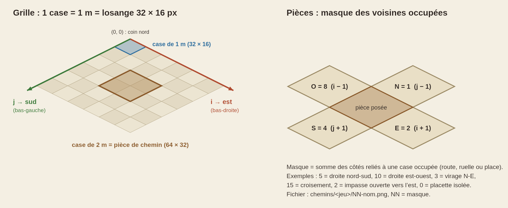
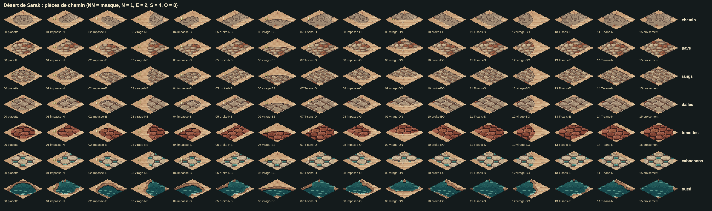
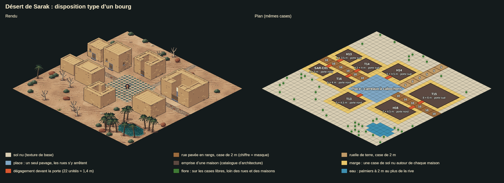
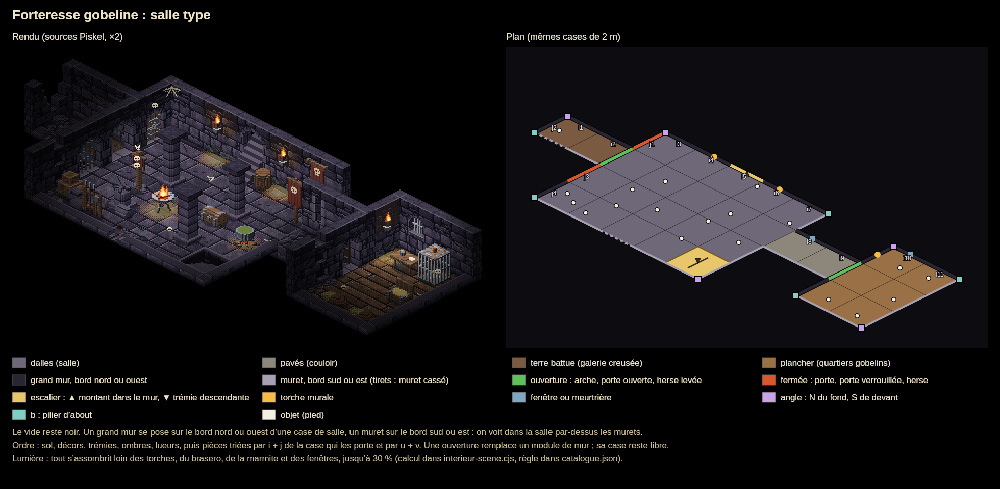

# Environnement isométrique : kit d'alimentation

Ce dossier rassemble les tuiles redessinées des biomes, prêtes à alimenter le jeu. **Le jeu ne les utilise pas encore.** Il garde ses tuiles actuelles tant que `jeu.json` ne liste aucun biome (voir « Brancher dans le jeu »).

| Biome | Dossier | Régions de l'atlas | Bâtiments à associer |
|---|---|---|---|
| Forêt tempérée de Teremor | `teremor/` | biome 6 (forêt) | famille `teremor` : T01–T04, H01–H04, TER-C01–C03, remparts TER-H01–H08 |
| Désert de Sarak | `sarak/` | biomes 1 et 2 (désert), zone de départ (Campement des Exilés) | famille `sarak` : T13–T16, H13–H16, SAR-C01–C03, remparts SAR-H01–H08 |

Les bâtiments communs (B01 grange, B05 halle de marché, B07 auberge-relais…) vont dans les deux biomes. Les tailles et les portes de chaque bâtiment sont dans le catalogue d'architecture (`sprites/architecture/architecture-isometric.js`, `entry(id)`).

Les intérieurs sont des salles fermées entourées de noir. Le premier est la **forteresse gobeline** (`interieurs/forteresse-gobeline/`), un donjon de pierre sombre ; voir la section « Intérieurs ». Le jeu n'a pas encore de rendu d'intérieur : le kit est prêt à brancher.

## Contenu

- `<biome>/png/` : **les images à utiliser**, une par élément. Le fichier `catalogue.json` donne pour chacune son rôle, sa taille, son ancre, son masque ou son opacité.
  - `sols/` : textures du sol (base, terre ou piste, pavés, eau, berge, litière ou éboulis, planches) et leur relief `-hauteur`.
  - `pavages/` : pavages de ville, en deux sens (`-rues-est-ouest`, `-rues-nord-sud`).
  - `chemins/<jeu>/NN-nom.png` : les 16 pièces de chaque jeu de chemin, rendues avec leur matière.
  - `chemins/formes/` : les mêmes pièces en niveaux (bord, intérieur, cœur), sans matière.
  - `falaises/` : paroi tournée vers le sud (éclairée) et paroi tournée vers l'est (à l'ombre).
  - `flore/` : chaque arbre, buisson ou rocher, et son ombre `-ombre`.
  - `decors/` : petits décors peints à plat sur le sol.
- `<biome>/` (hors `png/`) : les sources Piskel à retoucher, la palette `.gpl` et le `manifeste.json` (voir le `LISEZMOI.md` du biome).
- `interieurs/<id>/` : les intérieurs, avec leurs sources Piskel, leur palette, leur `manifeste.json` et leurs PNG dans `png/` (catalogue `png/catalogue.json`).
- `guide/` : les planches de ce guide.
  - `grille.png` : la grille et les masques.
  - `pieces-<biome>.png` : toutes les pièces numérotées.
  - `disposition-<biome>.png` : un bourg type, rendu et plan côte à côte.
  - `salle-<intérieur>.png` : une salle type, rendu et plan côte à côte.
  - `pieces-<intérieur>.png` : toutes les pièces d'un intérieur, chacune sur sa case.
- `jeu.json` : l'interrupteur des biomes dans le jeu.

## 1. Grille et ordre d'affichage

- Une case de 1 m est un losange de **32 × 16 px**. La projection est x = u − v, y = (u + v) / 2 − z, avec 16 unités par mètre (u = 16 i, v = 16 j).
- L'axe **i** va vers l'**est** (bas-droite de l'écran) et l'axe **j** vers le **sud** (bas-gauche). Le nord est en haut à droite, l'ouest en haut à gauche.
- Le sol se dessine d'abord, à plat. Tout ce qui a un pied (flore, bâtiments, personnages, parois de falaise) se dessine ensuite, trié par le y écran de son pied, du haut vers le bas.

## 2. Sols

- Une texture de sol ne se pose pas case par case : elle se répète **en coordonnées écran**. Le pixel (x, y) de l'écran prend le pixel (x mod largeur, y mod hauteur) de la texture. Les tailles sont des multiples de 32 × 16, donc les cases voisines se raccordent sans joint.
- Entre deux matières (herbe et terre, sable et piste…), le relief `-hauteur` décide : le pixel le plus haut l'emporte. Cela donne un bord irrégulier de 2 à 4 px plutôt qu'une ligne droite.
- Le sol de base reçoit de grandes plages plus claires et plus sombres (bloc `macro` du manifeste), puis les décors (point 6).

## 3. Chemins, routes et ruisseaux

- Les chemins se posent sur des **cases de 2 m** (64 × 32 px), alignées sur les cases paires de la grille. La pièce (ci, cj) couvre les cases i = 2 ci et 2 ci + 1, j = 2 cj et 2 cj + 1.
- Pour chaque case de 2 m occupée, on calcule le **masque** de ses voisines occupées : **N = 1** (cj − 1), **E = 2** (ci + 1), **S = 4** (cj + 1), **O = 8** (ci − 1). On pose ensuite la pièce `NN-nom.png` dont le numéro est ce masque.
  - 5 : droite nord-sud. 10 : droite est-ouest.
  - 3, 6, 12, 9 : virages.
  - 7, 11, 13, 14 : T.
  - 15 : croisement. 1, 2, 4, 8 : impasses. 0 : placette.
- Une place, ou le bord de la carte quand la route continue, compte comme une voisine occupée. Ainsi, une rue qui arrive sur une place reste ouverte de ce côté.
- Les jeux de pièces partagent trois formes (`chemin`, `pave`, `ruisseau`) remplies par une matière :

| Biome | Jeu | Forme | Matière | Usage |
|---|---|---|---|---|
| Teremor | `chemin` | chemin | terre | sentiers, ruelles de terre |
| Teremor | `pave`, `rangs`, `dalles`, `briques`, `eventail` | pavé | pavés, rangs, dallage, briques, éventail | routes et rues de ville |
| Teremor | `ruisseau` | ruisseau | eau | ruisseaux |
| Sarak | `chemin` | chemin | piste | pistes, ruelles de terre |
| Sarak | `pave`, `rangs`, `dalles`, `tomettes`, `cabochons` | pavé | grès, rangs, pisé, tomettes, cabochons | routes et rues de ville |
| Sarak | `oued` | ruisseau | eau d'oasis | oueds, canaux |

- Les PNG de `chemins/<jeu>/` sont des aperçus posés sur le sol de base. Dans le jeu, la matière se lit en coordonnées écran (point 2), sinon on verrait un joint entre deux pièces. Le compositeur `sprites/environnement/environment-iso.js` le fait à partir des formes.

## 4. Pavages de ville

- Chaque pavage existe en deux sens : `-rues-est-ouest` pour une rue le long de i, `-rues-nord-sud` pour une rue le long de j. Une place utilise un seul sens d'un bout à l'autre.
- Rues : les ruelles des centres régionaux sont pavées en **rangs**, les autres en **chemin** de terre.
- Places : un disque centré sur la localité, d'un rayon de 7 m pour un bourg, 5 m pour un port et 3,5 m pour les autres. Les rues **s'arrêtent au bord de la place** et ne la traversent pas.

| Localité | Teremor | Sarak |
|---|---|---|
| bourg | dallage, éventail, briques ou rangs | cabochons, tomettes, dalles de pisé ou pavés de grès |
| port | dallage ou rangs | dalles de pisé ou tomettes |
| relais | pavés ou rangs | pavés de grès ou dalles de pisé |
| ruine, refuge | pavés | pavés de grès |
| campement | pavés | aucune place |

Le choix dans chaque liste est fixe pour une localité donnée : il dépend de son identifiant.

## 5. Falaises et eau

- `paroi-face-sud.png` habille les parois tournées vers le sud (bas-gauche, éclairées), `paroi-face-est.png` celles tournées vers l'est (bas-droite, à l'ombre). Une paroi en biais prend la face sud assombrie d'un ton.
- Les parois sont dépliées : la colonne est x écran modulo 64, la ligne est la distance sous l'arête, 0 en haut. Les 40 lignes couvrent les falaises du jeu, de 24 à 32 px de haut.
- Le dessus d'une falaise reçoit la texture du sol avec un liseré clair sur l'arête (couleurs `accents` du manifeste).
- L'eau est bordée par la texture `berge`. Les ponts reçoivent `planches`, posées en travers du chemin.

## 6. Flore et décors

- Chaque sprite de `flore/` a une **ancre** (catalogue) : c'est son pied. On place l'ancre au centre de sa case (u = 16 i + 8, v = 16 j + 9).
- On dessine d'abord `-ombre.png`, à l'opacité du catalogue (0,45 en forêt, 0,5 au désert), puis le sprite trié avec les bâtiments et les personnages.
- Densités des planches, à prendre comme repère (dans le jeu, les objets du monde gardent leurs emplacements actuels) :
  - grands éléments (arbres, rochers, arbres morts) sur environ 3 à 8 % des cases libres ;
  - au désert, les palmiers seulement à 2 m au plus de l'eau, sur environ 30 % de ces cases ;
  - petits éléments (fougères, fleurs, touffes, cailloux) sur environ 3,5 % des cases de sol nu ;
  - décors au sol sur 8 % (forêt) ou 6 % (désert) des cases, peints à plat avec le sol.
- Aucune flore sur une rue, une place, une maison ou sa marge, ni sur une case voisine d'une rue.
- Correspondance avec les objets du jeu :
  - Forêt : `world_oak_*` donne chêne ou bouleau, `world_boulder_2` un rocher, `world_fern` une fougère, `world_mushrooms` des champignons, `world_flowers` des fleurs.
  - Désert : `rock_a`, `rock_b`, `rock_d` donnent des rochers, `rock_c` une cheminée de fée, `rock_e` des éboulis, `deadtree` un arbre mort, `shrub` un buisson, `palm` un palmier, `scrub` une touffe, `pebbles` des cailloux.

## 7. Disposition des maisons, places et ruelles

La planche montre un bourg type : le rendu à gauche, le plan des mêmes cases à droite. La même chose existe pour la forêt dans `guide/disposition-teremor.png`.

- **Emprise.** Une maison occupe *largeur × profondeur* mètres (catalogue d'architecture, `width/16 × depth/16`), alignée sur la grille de 1 m. En vue `droite` ou `gauche`, largeur et profondeur s'échangent.
- **Position dans le jeu.** La position (x, y) d'un bâtiment est le coin **sud-est** de son emprise, le plus proche du joueur. L'emprise s'étend vers l'ouest et vers le nord.
- **Porte.** La vue choisit le côté de l'entrée :
  - `face` : sud (bas-gauche) ;
  - `dos` : nord (haut-droite) ;
  - `droite` : ouest (haut-gauche) ;
  - `gauche` : est (bas-droite).

  La porte est à la fraction `entrances` de la façade (0,5 = au milieu). Devant chaque porte, il faut laisser **22 unités (environ 1,4 m)** dégagées, 32 pour les grandes portes F07–F11.
- **Orientation.** Une maison au nord d'une rue prend la vue `face`, une maison au sud la vue `dos`. Une maison qui borde une place tourne sa porte vers la place.
- **Marge.** Il faut garder **une case de sol nu** autour de chaque emprise : pas de flore, pas de décor, pas de pièce de chemin. Deux maisons voisines ont donc au moins 2 m entre leurs murs, et leurs marges peuvent se toucher.
- **Rues.** Une rue de 2 m passe à une case de la façade, juste au-delà de la marge. Le dégagement de la porte peut empiéter sur la rue.
- **Places.** Un seul pavage par place. Les maisons qui la bordent gardent leur marge, et les rues s'y arrêtent.
- **Désert.** Les campements n'ont pas de place pavée. Les palmiers se groupent autour des puits et des oasis, les rochers et les arbres morts restent hors des rues.

## 8. Intérieurs

Un intérieur est un espace fermé entouré de noir, comme dans les jeux de ce genre. La planche montre la salle type de la forteresse gobeline, avec le rendu à gauche et le plan des mêmes cases à droite. Toutes les pièces sont sur `guide/pieces-forteresse-gobeline.png`. Le code de référence qui fait l'assemblage est `scripts/environment/interieur-scene.cjs` : `layout()` choisit les pièces, `compose()` les dessine.

- **Grille.** Une case de salle fait **2 m** : 32 unités, un losange de 64 × 32 px, comme une pièce de chemin. i va vers l'est et j vers le sud. Le coin nord de la case (i, j) est en u = 32 i, v = 32 j. Un mur fait 48 unités de haut (3 m) et 8 d'épaisseur.
- **Plan.** On décrit la salle case par case : soit du vide, soit un sol (`dalles`, `paves`, `terre`, `planches`). Le vide reste **noir**, sans sol ni décor.
- **Sol.** Il se pose comme dehors : la texture est lue en coordonnées écran, et le relief `-hauteur` départage deux sols voisins.
- **Grands murs au fond.** Sur chaque bord **nord** ou **ouest** d'une case de sol qui touche le vide, on pose un module de `murs/nord/` ou `murs/ouest/`. Son ancre va sur le coin nord de la case, et son épaisseur est du côté du vide.
  - Murs pleins : `mur-a`, `mur-b` ou `mur-c`, tirés au hasard mais toujours les mêmes pour une case donnée.
  - Variantes : `mur-ruine`, `mur-breche`, `meurtriere`, `fenetre`, `baniere`, `chaines`, `mur-torche` (animée).
- **Murets devant.** Sur chaque bord **sud** ou **est** qui touche le vide, on pose un muret arasé de 6 unités (`murets/sud/`, `murets/est/`). On voit ainsi l'intérieur par-dessus. L'ancre va sur le coin ouest de la case pour un muret sud, sur le coin est pour un muret est. Quand la case au sud-ouest est aussi du sol, le muret sud prend `muret-debut` : c'est le muret est de cette case qui tient l'angle.
- **Angles.** Pour chaque sommet de la grille, on regarde ses quatre cases. S'il n'y a qu'une case de sol, l'angle dépend de sa position :
  - au sud-est du sommet : `angle-nord` (fond, entre deux grands murs) ;
  - au sud-ouest : `bout-nord` (pilier d'about) ;
  - au nord-est : `bout-ouest` (pilier d'about) ;
  - au nord-ouest : `angle-sud` (devant, entre deux murets).

  L'ancre de l'angle est le sommet.
- **Ouvertures.** Une porte remplace un module de grand mur : `arche`, `porte`, `porte-ouverte`, `porte-verrouillee`, `herse`, `herse-levee`, `escalier-montant`, `porte-cellule`, `porte-cellule-ouverte`, `porte-scellee` (animée). Entre deux salles, la porte se pose sur le bord nord ou ouest de la case du sud ou de l'est, et son épaisseur empiète sur la case de l'autre salle. On ne met aucun objet sur la case devant une ouverture. L'escalier montant occupe la case devant lui.
- **Escalier descendant et puits.** `escalier-descendant-nord` (ou `-ouest`) se pose par-dessus le sol d'une case, ancre au coin nord de la case. Le `puits` du monte-charge se pose de la même façon ; la plate-forme `monte-charge` est un objet posé au centre de cette case quand elle est à l'étage.
- **Objets et décors.** L'ancre d'un objet est son pied, en unités du monde. Les décors au sol se peignent juste après le sol. La `toile` va dans le coin nord d'une salle, ancre au coin nord de la case du coin.
- **Ombres et lueurs.** Les calques `-ombre.png` (opacité 0,5) puis `-lueur.png` (0,35 pour le feu, 0,3 pour la lune) se peignent **seulement sur les pixels de sol**, avant toutes les pièces. Les torches et le brasero ont 4 images, à 8 images/s.
- **Ordre.** On dessine d'abord le sol, les décors au sol, les trémies, les ombres et les lueurs. Viennent ensuite les pièces debout, triées par i + j de la case qui les porte, puis par u + v. Pour un mur ou un muret, c'est la case de vide qui porte son épaisseur. Un personnage se trie comme un objet.
- **Lumière.** Pour finir, tout s'assombrit loin des sources de lumière, jusqu'à 30 % de la luminosité. Les sources sont les pièces qui ont un champ `lumiere` dans le catalogue : torches, brasero, marmite, fenêtres, porte scellée et cage de la fée. On garde des paliers de 1/8, tramés (Bayer 4 × 4), pour rester en pixel art. Le personnage peut porter sa propre source.
- **Cloisons.** Un grand mur entre deux salles cache le sol sur environ 1,5 case derrière lui. Quand un personnage passe derrière, on dessine ce mur à 40 % d'opacité.
- **Donjons.** Un donjon complet (plusieurs étages, clés, leviers, monte-charge) est décrit dans `data/donjons/<id>.json` et rendu par `npm run donjon:environment` dans `donjons/<id>/`. Voir `donjons/LISEZMOI.md`.

## 9. Brancher dans le jeu

1. Mettre les biomes voulus dans `jeu.json`, par exemple `{"biomes_actifs": ["teremor", "sarak"]}`.
2. Lancer `npm run build:environment`, puis `python3 scripts/package-ios.py`. Cela réintègre le jeu web et iOS et refait `Hearthreaver-iOS.zip`.

Le jeu dessine alors les régions du biome avec le compositeur (`sprites/environnement/environment-iso.js`) et les données `sprites/environnement/<biome>-data.js`. Les autres biomes ne changent pas, et les murs de la zone de départ gardent leur dessin. Pour revenir aux tuiles actuelles, on vide la liste et on relance la seconde commande.

Les intérieurs n'ont pas encore de rendu dans le jeu. Pour les brancher, on reprend les règles de la section 8 : `png/catalogue.json` donne chaque pièce, son ancre, ses calques et sa lumière, et `scripts/environment/interieur-scene.cjs` sert de modèle.

## 10. Retoucher et régénérer

1. Retoucher le `.piskel` dans piskelapp.com (voir `<biome>/LISEZMOI.md` ou `interieurs/<id>/LISEZMOI.md`).
2. `npm run build:environment` : données du jeu (biomes seulement).
3. `npm run kit:environment` : PNG, catalogues et planches de ce dossier.
4. `npm run donjon:environment` : planches des donjons (`donjons/`), après une retouche du kit ou des données d'un donjon.
5. `npm run test:environment` : vérifie que tout est à jour et raccordé.
