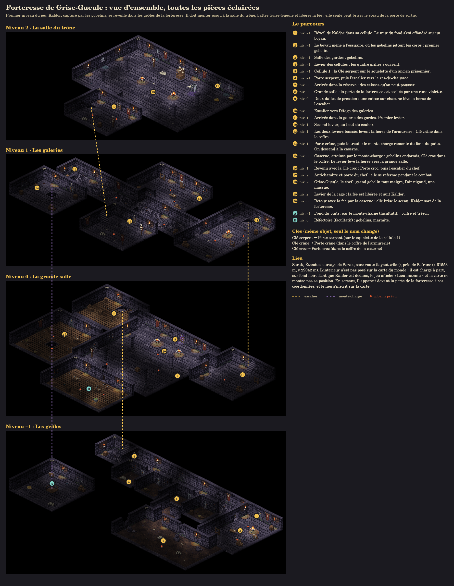

# Donjons

**Intégration jouable :** la Forteresse de Grise-Gueule est le premier niveau des nouvelles parties web et iOS. Voir [le parcours, les commandes et la sauvegarde](../../../docs/premier-niveau.md). Le reste de ce guide décrit les données et les planches de conception.

Un donjon est un intérieur complet, sur plusieurs étages, assemblé avec le kit d'un intérieur (`../interieurs/<kit>/`). Il flotte dans le noir et n'est pas posé sur la carte du monde : le jeu le charge à part quand le héros entre, et revient au monde quand il sort.

- Données : `data/donjons/<id>.json` (plans, murs, objets, clés, mécanismes, repères, lieu dans le monde).
- Planches : `donjons/<id>/`, refaites par `npm run donjon:environment`.
- Code : `scripts/environment/donjon.cjs`. Les règles d'assemblage sont celles des intérieurs, dans `../LISEZMOI.md`, section « Intérieurs ».
- Test : `tests/environment-donjons.test.cjs`. Il vérifie que chaque pièce existe dans le kit, que les clés ouvrent les bonnes portes, que les escaliers et le puits se répondent d'un étage à l'autre, qu'aucun objet ne bouche une ouverture, que chaque case est accessible une fois les portes ouvertes, et que les pièces fermées sont dans le noir au départ.

## Pièces dans le noir

Une pièce fermée par une porte verrouillée, une herse baissée ou une grille de cellule reste dans le noir tant qu'elle est fermée. On devine ses murs à 14 % de leur luminosité, en trame, mais pas son contenu. Quand un levier, une clé ou des dalles l'ouvrent, elle s'éclaire en une demi-seconde. Une pièce qu'on atteint par le monte-charge s'éclaire quand le héros y arrive.

- Les pièces se calculent toutes seules : deux cases voisines font partie de la même pièce, sauf si un mur ou une ouverture fermée les sépare (`rooms()` dans `donjon.cjs`).
- Au départ, seules les pièces d'arrivée sont visibles : celle du réveil, et celles du haut ou du bas d'un escalier.
- Un mur ou une porte entre une pièce éclairée et une pièce dans le noir reste éclairé : on le voit depuis la pièce où l'on est.
- Les torches d'une pièce dans le noir n'éclairent pas les pièces voisines.
- Réglages dans le JSON, bloc `obscurite` : les ouvertures qui ferment une pièce (`fermetures`) et la luminosité d'une pièce fermée (`luminosite`). Chaque levier, dalle ou porte à clé liste dans `ouvre` les bords qu'il ouvre.

Les planches d'étage montrent ce que le héros voit en arrivant. La vue d'ensemble montre toutes les pièces éclairées.

## Forteresse de Grise-Gueule

C'est le premier niveau du jeu. Kaldor, capturé par les gobelins, se réveille dans les geôles de la forteresse. Il doit monter jusqu'à la salle du trône, battre Grise-Gueule et libérer la fée, car elle seule peut briser le sceau de la porte de sortie.

**Lieu.** La forteresse est à Sarak, dans l'étendue sauvage sans route, près de Safrane (x 61553 m, y 29042 m). Sarak est le territoire où les gobelins sont le plus nombreux, avec le clan Kesh et ses pillards qui capturent des voyageurs. Tant que Kaldor est à l'intérieur, le jeu affiche « Lieu inconnu » et la carte ne montre pas sa position. En sortant, il apparaît devant la porte de la forteresse et le lieu s'inscrit sur la carte.

**Étages.**

| Niveau | Étage | Planche |
|---|---|---|
| 2 | La salle du trône | `forteresse-grise-gueule/etage-2-trone.png` |
| 1 | Les galeries | `forteresse-grise-gueule/etage-1-galeries.png` |
| 0 | La grande salle | `forteresse-grise-gueule/etage-0-grande-salle.png` |
| −1 | Les geôles | `forteresse-grise-gueule/etage-m1-geoles.png` |

**Parcours.**

1. **Geôles.** Le mur du fond de la cellule s'est effondré. Un boyau mène à l'ossuaire, puis à la salle des gardes, où un levier ouvre les quatre grilles de cellule. Dans la cellule 1, la **Clé serpent** est sur un squelette. Elle ouvre la **Porte serpent** de l'escalier.
2. **Grande salle.** La porte de la forteresse est scellée par une rune violette. Pour lever la herse de l'escalier, il faut pousser une caisse sur chacune des deux dalles de pression.
3. **Galeries.** Deux leviers, un dans la galerie des gardes et un au bout du couloir, lèvent ensemble la herse de l'armurerie. La **Clé crâne** est dans le coffre de l'armurerie. Elle ouvre la **Porte crâne** de la salle du treuil. Le treuil remonte le monte-charge du fond du puits.
4. **Monte-charge.** Il descend à la caserne de la grande salle, fermée jusque-là. La **Clé croc** est dans un coffre, et un levier lève la herse vers la grande salle : c'est le raccourci du retour. On peut aussi descendre au fond du puits, sous les geôles, pour un trésor facultatif.
5. **Salle du trône.** Derrière la **Porte croc**, l'escalier du chef mène à l'antichambre. Le chef **Grise-Gueule** est un grand gobelin tout maigre, l'air nigaud, armé d'une massue. Une fois le chef battu, le levier fait descendre la cage et la fée est libérée.
6. **Sortie.** Kaldor redescend par le monte-charge et la caserne avec la fée, qui brise le sceau de la grande porte.

Les trois clés sont le même objet (`cle`), seul leur nom change. Les gobelins prévus sont marqués en rouge sur les planches. Leur design de base est proposé dans `art/gobelins/` ; ils sont maintenant placés et combattent dans le premier niveau jouable.

## Modifier un donjon

Le fichier JSON décrit chaque étage case par case, comme la salle type des intérieurs :

- `plan` : une ligne par rangée j (du nord au sud), un caractère par colonne i (d'ouest en est). `#` est le vide noir, `.` des dalles, `,` des pavés, `:` de la terre battue et `=` du plancher. Tous les étages partagent la même grille : le puits du monte-charge est à la même case partout.
- `murs` : la pièce posée sur un bord nord ou ouest, sous la forme `"i,j,N": "porte-cellule"`. Entre deux cases de sol, un mur fait une cloison ; une porte ou une herse fait un passage.
- `murets` : un muret particulier sur un bord sud ou est (`"i,j,S": "muret-casse"`).
- `escaliers` : les trémies `[i, j, "nord" | "ouest" | "puits"]`.
- `objets`, `decors`, `gobelins`, `reperes` : des positions en cases. `[3.5, 2.5]` est le centre de la case (3, 2).
- `portes`, `mecanismes`, `liens` : ce que fait chaque porte, levier ou escalier, pour le jeu.

Après une modification, lancer `npm run donjon:environment`, puis `npm run test:environment`.
