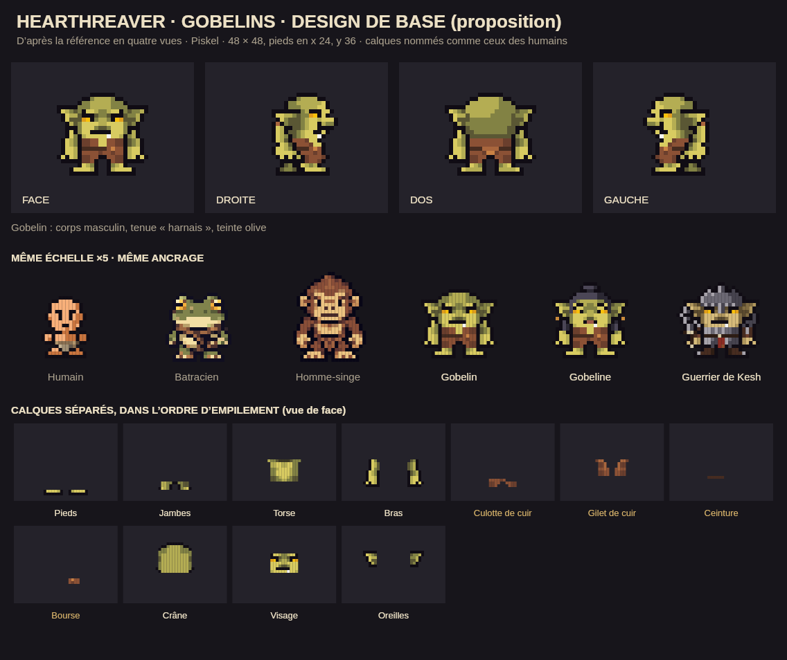
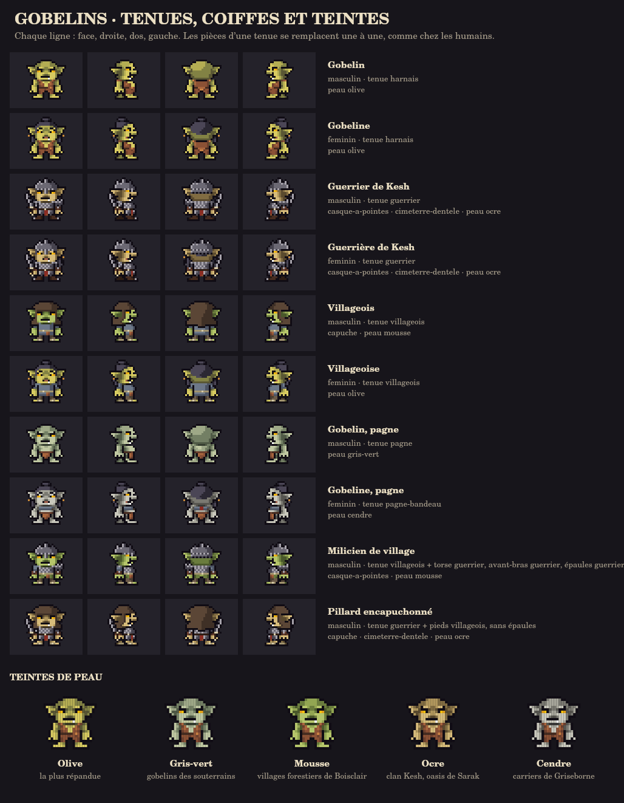

# Gobelins

Proposition de design, à valider, d'après la référence en quatre vues de Lino : grosse tête ronde, longues oreilles en pointe, yeux jaunes sous des sourcils froncés, nez en bulbe, un croc, peau olive, gilet de cuir ouvert, culotte, ceinture et bourse. Les gobelins sont dessinés dans Piskel, en calques séparés comme les humains : corps, oreilles, visage, cheveux, habits pièce par pièce, coiffe, arme. L'armure de guerre reste de fer noirci, avec des plaques dentelées, des pointes et de la rouille, dans l'esprit des gobelins de la Moria.





## Format

- Cadre de 48 × 48, pieds à l'ancre x 24, y 36, comme les hommes-singes et les batraciens. Le moteur ajoute 16 sur les deux axes, ce qui donne le cadre 80 × 80 des humains, avec l'ancre en 40, 52.
- Quatre cadres par fichier, dans l'ordre des humains : face, droite, dos, gauche.
- Contour d'encre `#100c14`, alpha binaire.
- Un gobelin fait 22 pixels de haut, des pieds au haut du crâne, dont 11 pour la tête : c'est la proportion de la référence. Son corps est plus court que celui d'un humain, mais sa tête le rend un peu plus haut, et ses oreilles le rendent beaucoup plus large (22 pixels).

## Fichiers

| Dossier | Contenu |
|---|---|
| `corps/` | `masculin` et `feminin`. Les deux ont la même silhouette, si bien que chaque tenue va aux deux. Le corps féminin a son propre visage (cils, lèvres), un chignon noir avec deux tresses et des anneaux d'oreille. |
| `tenues/` | `harnais` (la tenue de la référence : gilet de cuir, culotte, ceinture, bourse), `pagne`, `pagne-bandeau`, `villageois` (tunique de laine, manches courtes, braies, corde, bourse, bandes de pied) et `guerrier` (cotte de mailles rouillée, tassettes, spalière dentelée, brassards de cuir clouté, bottes ferrées). |
| `coiffes/` | `capuche` (fendue pour les oreilles) et `casque-a-pointes` (avec nasal). |
| `armes/` | `cimeterre-dentele`, tenu dans la main droite. |
| `gobelins.json` | Teintes de peau et personnages assemblés. |
| `planches/` | Planches de validation. |
| `exports/` | Une bande de 192 × 48 par personnage (face, droite, dos, gauche). |
| `palette-gobelins.gpl` | Palette à importer dans Piskel. |

## Calques

Les noms suivent ceux des humains (`sprites/humains/sources-natives.js`), pour que les deux peuples se ressemblent dans les outils.

| Calque | Pièce |
|---|---|
| `ANATOMIE 10` à `13` | pieds, jambes, torse et cou, bras et mains |
| `07 Crane`, `07 Crane - Oreilles`, `08 Visage` | tête ; les oreilles et le visage (sourcils, yeux, nez, bouche, croc) sont des calques à part |
| `CHEVEUX`, `BIJOUX` | chignon et tresses, anneaux |
| `HABIT 10` | pieds |
| `HABIT 11` | jambes |
| `HABIT 12` | torse |
| `HABIT 13` | manches |
| `HABIT 14` | pans, pagne, tassettes |
| `HABIT 15` | ceinture |
| `HABIT 16` | bourse |
| `HABIT 17` | avant-bras |
| `HABIT 18` | épaules |
| `HABIT 19` | cape |
| `COIFFE 21` | capuche, casque |
| `MASQUE COIFFE` | zone où la coiffe cache les cheveux ; ce masque n'est jamais dessiné |
| `ARME - … (devant)` / `(derriere)` | l'arme en main ; vue de gauche, elle passe derrière le corps |
| `REFERENCE - …` | le corps, à demi transparent, pour dessiner une pièce en place ; ce calque n'est jamais assemblé |

## Assemblage

`gobelins.json` décrit chaque personnage : un corps, une tenue, une coiffe et une arme (toutes deux facultatives), et une teinte de peau.

- **Remplacer une pièce.** `pieces` remplace une pièce de la tenue par celle d'une autre tenue, comme `compose()` chez les humains. Par exemple, `"pieces": {"tunic": "guerrier"}` met la cotte de mailles sur un villageois. `null` retire la pièce.
- **Ordre des calques.** De bas en haut : arme dans le dos, corps, habits (10, 11, 12, 14, 15, 16, 13, 17, 18, 19), tête, cheveux, coiffe, oreilles, bijoux, arme en main. Les oreilles passent par-dessus la coiffe.
- **Masque de coiffe.** Il cache les cheveux. Le casque cache le chignon, mais on voit encore les tresses dessous. La capuche cache tout.
- **Teintes de peau.** Une teinte remplace les cinq tons de peau du corps :
  - olive, la teinte de la référence ;
  - gris-vert, dans les souterrains ;
  - mousse, à Boisclair ;
  - ocre, pour le clan Kesh ;
  - cendre, à Griseborne.

## Retoucher

1. Ouvrir le `.piskel` sur piskelapp.com (Open). La palette s'importe depuis `palette-gobelins.gpl`.
2. Garder le cadre de 48 × 48, les quatre cadres et les noms de calques. Pour ajouter une pièce, créer un calque `HABIT nn - Nom` dans une tenue. Pour ajouter une tenue ou une coiffe, créer un fichier dans le bon dossier.
3. Lancer `npm run gobelins` pour refaire les planches et les exports, puis `npm run test:gobelins`.

Le premier jet vient de `scripts/gobelins/dessins.cjs`, des dessins en caractères : le corps nu, découpé en calques par zones, puis le gobelin habillé de chaque tenue, coiffe ou chevelure, dont les pixels qui diffèrent du corps nu forment les calques. `npm run draft:gobelins` n'écrit que les fichiers absents : les `.piskel` sont la source, et `--ecraser` effacerait les retouches.

## Animations et intégration

Le rig `sprites/gobelins/gobelin.js` anime les dix variantes natives et Grise-Gueule dans les quatre vues. Il propose repos, marche, course, alerte, garde, parade, quatre attaques, réaction au coup, déséquilibre, mort, interaction, parole, portage, travail, assise, sommeil, protection et joie. Les activités sont disponibles dans l’atelier ; le donjon utilise les états de déplacement et de combat selon son comportement existant.

[Atelier animé](animations/index.html) · [Aperçu à vitesse réelle](animations/gobelins-animations.gif) · [Poses](animations/poses.png).

Le compilateur lit les Piskel sans les modifier. Il conserve intégralement les pixels et les formes connectées de chaque calque. Les formes déjà disjointes des membres peuvent se déplacer séparément, sans découper une forme connectée, sans ajouter de membre, sans étirement et sans rotation des membres. Les manches et brassards suivent le bras correspondant, les bottes suivent les pieds ; tête, visage, oreilles, cheveux et coiffes restent groupés. Les masques de coiffes et teintes sont ceux de l’assemblage original. Les quatre vues gardent le cadre natif 80 × 80 et l’ancre 40,52.

Les attaques tiennent six poses : mise en tension, charge, impact, prolongement, fin extrême, reprise. L’impact dure 45 ms ; le chef charge et freine plus lentement. Les tailles alternent leur sens, puis viennent un estoc et une frappe lourde. Le smear clair suit la livraison du coup et un résidu atténué apparaît juste après ; la fin de geste reste nette. Seules les armes du catalogue tournent. La marche avance avec la distance parcourue et revient au repos dès l’arrêt.

Dans Grise-Gueule, le même chronomètre pilote pose et unique événement de dégâts. L’orientation est fixée au départ dans la vue isométrique ; les dégâts vérifient le segment de lame et le mur à l’impact. Une blessure annule une frappe encore en préparation. Les gobelins s’approchent jusqu’à la portée visible de leur arme. La mort se joue en cinq poses puis reste au sol ; les cadavres des anciennes sauvegardes sont déjà stabilisés.

Grise-Gueule emploie provisoirement les calques de guerrier en teinte cendre, à leur taille native, avec le Marteau de Griseborne. Cela remplace l’ancien étirement vertical du gobelin de base. Sa silhouette spécifique de grand chef maigre reste à dessiner comme source Piskel dédiée.

```sh
npm run build:goblin-animations
npm run preview:goblin-animations
npm run test:goblin-animations
node --test tests/goblin-combat.test.cjs tests/dungeon-presentation.test.cjs
```

Après une retouche Piskel, reconstruire les calques puis l’atelier. `build:dungeon` reconstruit aussi le rig avant d’embarquer le donjon ; `embed-dungeon` installe les sources dans les HTML du jeu et d’iOS. Les gobelins civils ne sont pas ajoutés au monde par ce changement : les états d’activité sont prêts à être appelés par leurs futurs comportements.

## Combat partagé dans le donjon

Le donjon utilise le traitement commun des dégâts (puissance, riposte, sons de frappe lourde, sang, recul, hit stop, shake et butin). Son adaptateur conserve uniquement la réaction du rig gobelin et les conséquences de quête de Grise-Gueule. L’anneau de cible appelle `Renderer.targetRing`, avec une seule projection aux pieds ; les anciens grands cercles de préparation sont retirés. Le déplacement pendant un coup ciblé reprend la vitesse de combat commune. Les prises en main et les six poses de Kaldor restent celles des armes natives.

Les armes lâchées restent sur leur étage et survivent à la sauvegarde. La première collecte utilise l’encart commun à deux lignes, positionné au-dessus de l’arme ; une arme déjà possédée n’ajoute aucun encart. La vérification téléphone contrôle aussi cet ancrage et les effets de contact.
